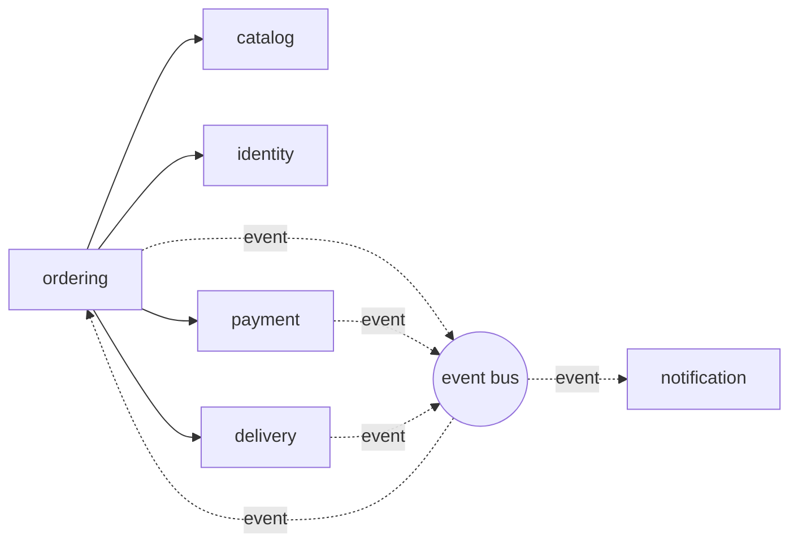

# FoodHub backend · module map (Part A)

## Modules
| Module | Responsibility (one sentence) | Data it owns | Operations it offers |
|---|---|---|---|
| identity | Authenticates users and issues access tokens. | Users, credentials, tokens | `login(username, password)`, `verifyToken(token)` |
| catalog | Keeps the restaurants and menus customers can order from. | Restaurants, menu items, prices | `list(limit, offset)`, `restaurantExists(id)` |
| ordering | Runs the life of an order from placement to delivery or cancellation. | Orders, order status, idempotency keys | `place(restaurantId, items, key?)`, `get(id)`, `changeStatus(id, status)` |
| payment | Charges customers and refunds money. | Payments (amount, status, provider reference) | `charge(orderId, amount)`, `refund(paymentId)` |
| delivery | Assigns a courier and tracks the delivery. | Couriers, deliveries | `dispatch(orderId, address)`, `getStatus(orderId)` |
| notification | Tells customers and restaurants what happened to an order. | Message log, message templates | `send(userId, template, params)` (only triggered by events) |

This week only `catalog` and `ordering` are implemented in code. The other four modules are planned.

## Who calls whom
Direct calls (an arrow means "imports the other module's service"):

Solid arrows are direct calls between modules. Dotted arrows are events sent through the event bus. The bus is not a module, so it adds no dependency between modules.

## Cycles and how they were broken
1. **ordering <-> payment.** Ordering calls `payment.charge()`, and payment must tell ordering that the payment succeeded. Fix: payment never imports ordering. It publishes a `PaymentSucceeded` or `PaymentFailed` event, and ordering subscribes to it.
2. **ordering <-> delivery.** Ordering calls `delivery.dispatch()`, and delivery must tell ordering that the order was delivered. Fix: delivery publishes an `OrderDelivered` event and ordering subscribes to it.
3. **notification.** To avoid ordering -> notification and a later notification -> ordering call, notification only listens to events and calls no other module.

After these changes the call graph has no cycles: identity, catalog, payment, delivery and notification are leaves, and only ordering depends on other modules.
