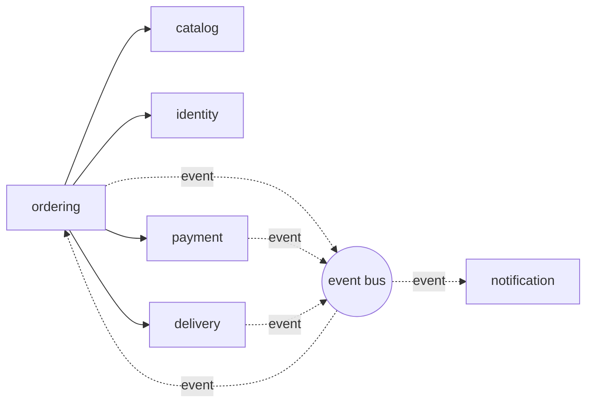

# Week 5 · Practice record · Modular monolith with NestJS modules
Name: Chiv Inthera
Id: p20240019
Date: 2026-11-06 · Project: FoodHub backend (`foodhub-api`)

## Part A · Module map

| Module | Responsibility (one sentence) | Data it owns | Operations it offers |
|---|---|---|---|
| identity | Authenticates users and issues access tokens. | Users, credentials, sessions | `login(username)`, `verifySession(sid)` |
| catalog | Keeps the restaurants and menus customers can order from. | Restaurants, menu items, prices | `list(limit, offset)`, `restaurantExists(id)` |
| ordering | Runs the life of an order from placement to delivery or cancellation. | Orders, order status, idempotency keys | `place(restaurantId, items, key?)`, `get(id)`, `changeStatus(id, status)` |
| payment | Charges customers and refunds money. | Payments (amount, status, provider reference) | `charge(orderId, amount)`, `refund(paymentId)` |
| delivery | Assigns a courier and tracks the delivery. | Couriers, deliveries | `dispatch(orderId, address)`, `getStatus(orderId)` |
| notification | Tells customers and restaurants what happened to an order. | Message log, message templates | `send(userId, template, params)` (only triggered by events) |

This week `catalog` and `ordering` are implemented as NestJS modules. The login and session code stays in `AuthController` for now (it becomes the identity module later). Payment, delivery and notification are planned.

### Who calls whom

Solid arrows are direct calls between modules. Dotted arrows are events through the event bus, which is not a module, so it adds no dependency between modules.

### Cycles found and how they were broken
1. **ordering <-> payment.** Ordering calls `payment.charge()`, and payment must tell ordering that the payment succeeded. Fix: payment never imports ordering. It publishes `PaymentSucceeded` or `PaymentFailed` and ordering subscribes (event).
2. **ordering <-> delivery.** Ordering calls `delivery.dispatch()`, and delivery must tell ordering that the order was delivered. Fix: delivery publishes `OrderDelivered` and ordering subscribes (event).
3. **notification.** It only listens to events and calls no other module, so no cycle can form.

After these changes the graph has no cycles: identity, catalog, payment, delivery and notification are leaves, and only ordering depends on other modules.

## Part B · Checks

| Check | Result |
|---|---|
| All week 4 endpoints still work (list which you tested) | Tested with `node scripts/week4-regression.mjs` against the refactored API, 14 of 14 passed: PASS GET /v1/restaurants?limit=2 -> 200, 2 items, total 3 PASS POST /v1/orders (valid) -> 201 PLACED PASS POST /v1/orders (restaurantId "a", items []) -> 400 PASS POST /v1/orders, restaurant 99 -> 404 PASS GET /v1/orders/{id} (exists) -> 200 PASS GET /v1/orders/{id} (missing) -> 404 PASS PATCH PLACED -> COOKING -> 200 PASS PATCH PLACED -> DELIVERED -> 409 PASS PATCH with an invalid status -> 400 PASS POST with Idempotency-Key abc-123: 1st -> 201, 2nd -> 200, same order PASS POST /v1/login sets the sid cookie PASS GET /v1/me with the cookie -> 200 dara PASS GET /v1/me without a cookie -> 401 PASS CORS: allows http://localhost:5173 with credentials The Vue page at http://localhost:5173 still lists the restaurants, and Log in as dara and Who am I? work. |
| Output of the grep dependency check | `grep -rn "catalog.repository" src/ordering` finds nothing: **OK**. |
| Error message when CatalogRepository is injected into OrdersService | `Nest can't resolve dependencies of the OrdersService (Symbol(ORDER_REPOSITORY), CatalogService, ?). Please make sure that the argument CatalogRepository at index [2] is available in the OrderingModule module.` (UnknownDependenciesException; the app exits at start-up). |
| Why does Nest refuse to start? | `CatalogRepository` is a provider of `CatalogModule`, but that module exports only `CatalogService`. `OrderingModule` can therefore not see the repository. Nest builds the dependency graph at start-up, finds no provider for that constructor argument in the OrderingModule context and stops. The module system itself enforces the boundary. |

## Part C · ADR-002

| Section | Your text |
|---|---|
| Title | ADR-002: Internal structure of the FoodHub backend |
| Status | Accepted, 2026-11-06 |
| Context | FoodHub is built by a team of 3 to 4 students and runs as one NestJS application covering identity, catalog, ordering, payment, delivery and notification. In week 4 the code was flat: controllers held business rules (idempotency, allowed status changes) and read and wrote shared Maps in `data.ts`, so storage was tied to the logic. Week 10 adds PostgreSQL, so ordering must be able to change its storage without changing its rules. Options considered: (1) layered, (2) modular monolith, (3) hexagonal. |
| Decision | Build a **modular monolith** with one NestJS module per business area, and use **ports and adapters** at the storage boundary of the ordering module. A module shares only its service (`exports: [CatalogService]`) and keeps its repository private. `OrdersService` depends on the `OrderRepository` port, and `OrderingModule` binds that port to `InMemoryOrderRepository` in one line. Controllers handle HTTP only; business rules live in services. Pure layering was rejected because it does not stop one area from reaching into another. Full hexagonal for every module was rejected because it adds interfaces we do not need yet. |
| Consequences | **Positive:** each module owns its data and exposes only its service; Nest enforces the boundary at start-up; week 10 can add a PostgreSQL adapter by changing one provider line; services can be tested without HTTP or a database; one deployable app is simple for a small team and a module can become a service later. **Negative:** the boundary is checked at start-up, not at compile time, so we keep the grep check; a port and an adapter add files and indirection for a small codebase; one process means one scaling unit and one failure domain; data is lost on restart until the PostgreSQL adapter exists. |

## Checklist
- [x] Module map with responsibilities, owned data and no cycles
- [x] Code reorganised into NestJS modules; `OrdersService` uses the repository port
- [x] All week 4 endpoints still work; dependency check passes; the "break the rule" error explained
- [x] ADR-002 written
